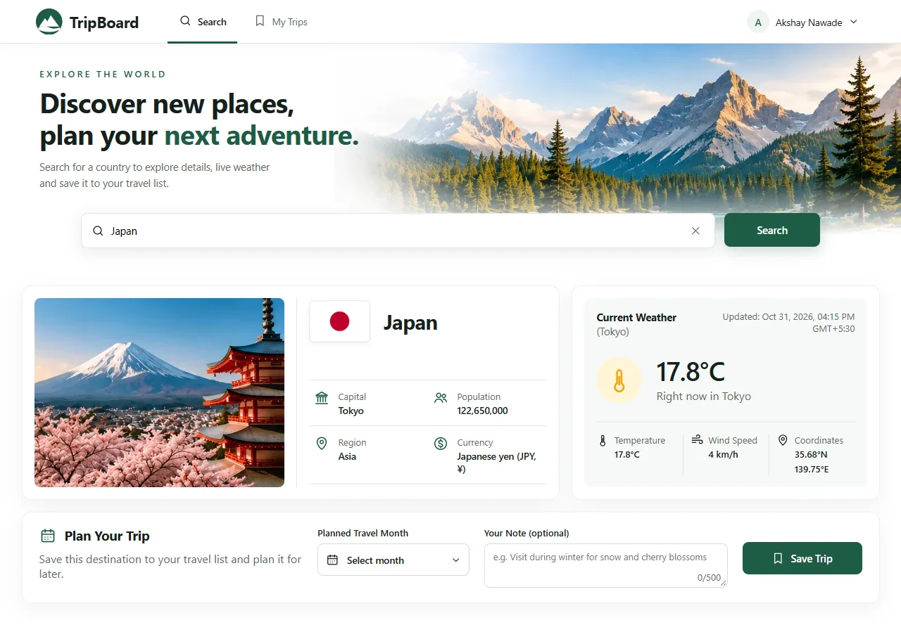
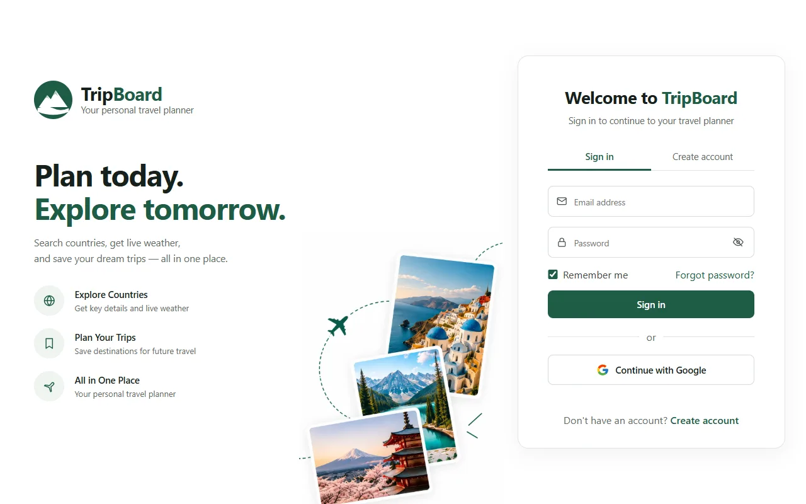
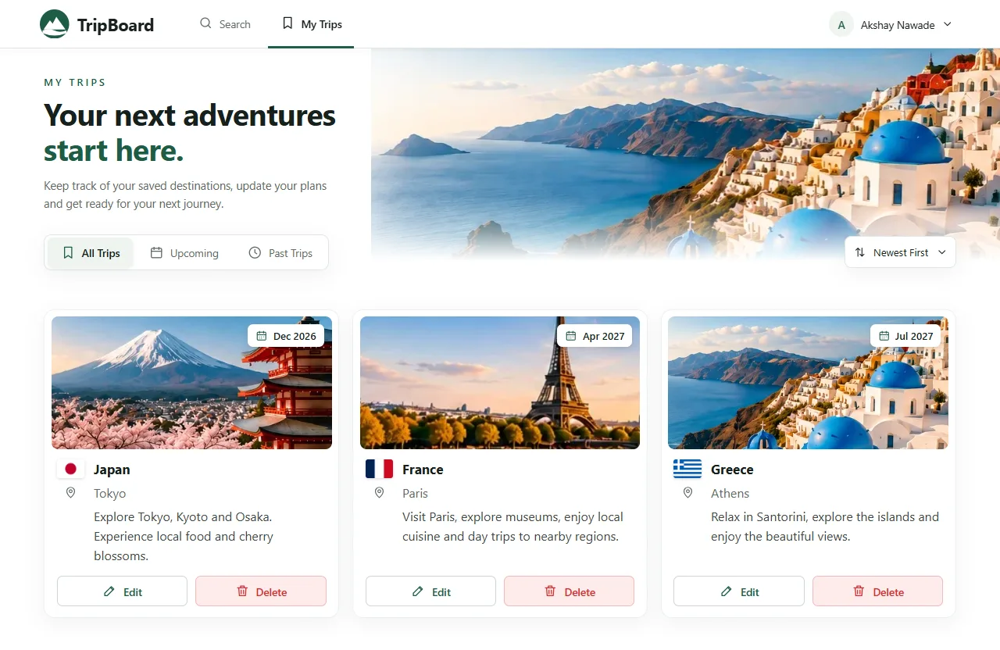
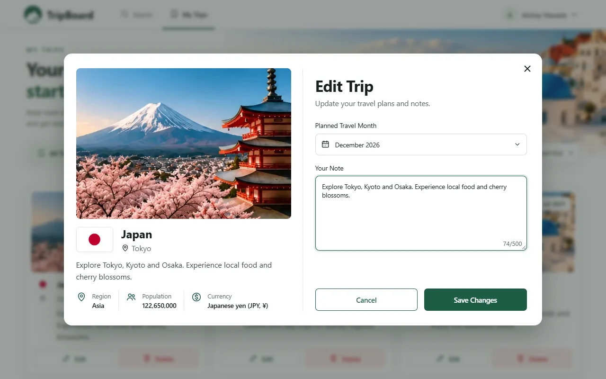
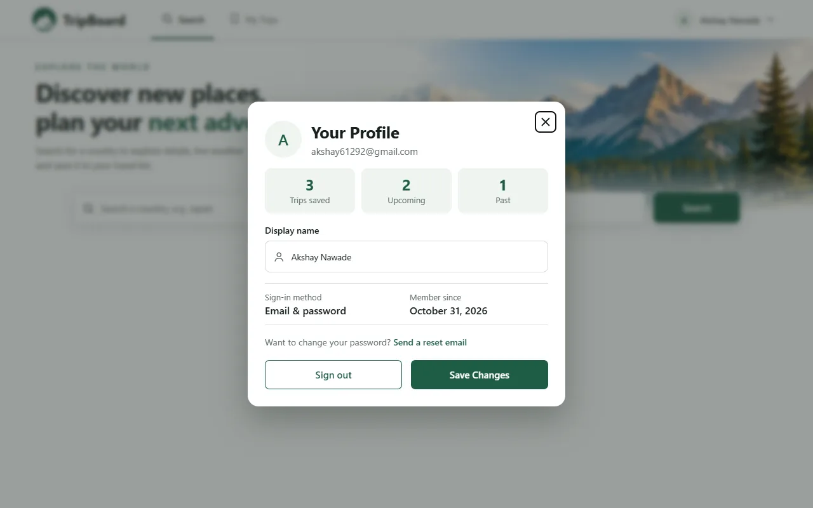
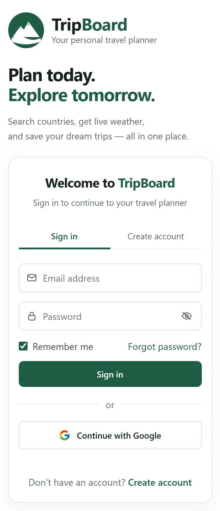
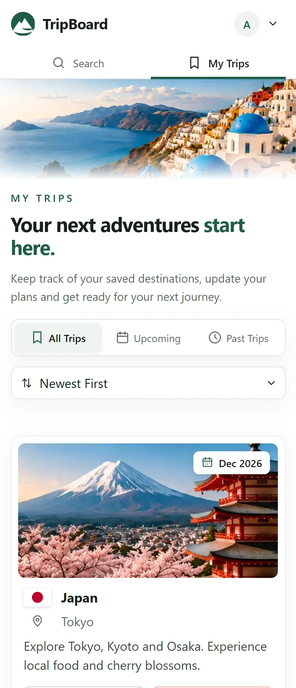
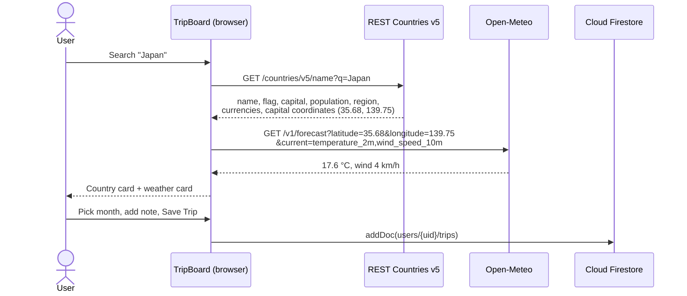

<div align="center">

# 🗺️ TripBoard

**A mini travel planner: search any country, see live details and weather in its capital, and save trips to your personal list in the cloud.**

[](https://tripboard-31aaf.web.app)


</div>



---

## 📑 Contents

- [Features](#-features)
- [Screenshots](#-screenshots)
- [How the API chaining works](#-how-the-api-chaining-works)
- [Firebase: auth, data model & security](#-firebase-auth-data-model--security)
- [REST Countries v3.1 → v5 migration](#-rest-countries-v31--v5-migration)
- [Tech stack & project structure](#-tech-stack--project-structure)
- [Run it yourself](#-run-it-yourself)
- [Known limitations](#-known-limitations)
- [AI usage](#-ai-usage)

---

## ✨ Features

### Required by the brief

| Feature | Details |
|---|---|
| **Sign in** | Firebase Authentication with **Google** and **email/password** |
| **Search screen** | Search a country by name. Shows **flag, name, capital, population, region, currency** |
| **Live weather** | Current temperature and wind in the capital, from Open-Meteo, using the capital's coordinates from REST Countries |
| **Save Trip** | Save the country with a **planned travel month** and a **short note** to Cloud Firestore |
| **My Trips** | List all saved trips, **edit** and **delete** them |
| **Hosting** | Deployed on Firebase Hosting (free Spark plan) |

### Beyond the brief

- 🎨 **Designed, responsive UI** for desktop and mobile
- 🔐 **Sign-in extras:** Sign in / Create account tabs, show/hide password, *Remember me*, *Forgot password* (reset email), readable error messages
- 🔎 **Search extras:** clear button, weather card with wind speed, capital coordinates and update time, country photos (Japan, France, Greece) with a flag fallback for other countries
- 🗓️ **Month picker** listing the next 24 months, and a note **character counter**
- 🧭 **My Trips:** filters **All / Upcoming / Past** (by planned month), sorting **Newest / Oldest / Travel date**, empty state
- ✏️ **Edit Trip dialog:** change both the **travel month** and the **note**
- 👤 **Profile:** edit display name, trip stats (total / upcoming / past), sign-in method, member since, password reset (email accounts only), sign out

---

## 📸 Screenshots

| Sign in | Search |
|---|---|
|  |  |

| My Trips | Edit Trip |
|---|---|
|  |  |

| Profile | Mobile |
|---|---|
|  |   |

> Screenshots use sample trips for illustration.

---

## 🔗 How the API chaining works

The weather call **depends on** the result of the country call: Open-Meteo needs the capital's latitude and longitude, which only REST Countries provides.



The chain lives in [`public/api.js`](public/api.js) (the `API 1` / `API 2` comments are added here for clarity):

```js
export async function fetchCountryWithWeather(name) {
  const country = await fetchCountry(name);          // API 1: REST Countries
  let weather = null;
  let weatherError = null;
  if (country.lat != null && country.lng != null) {
    try {
      weather = await fetchWeather(country.lat, country.lng); // API 2: uses API 1's coordinates
    } catch (e) {
      weatherError = e.message; // country info is still useful if weather fails
    }
  } else {
    weatherError = "No capital coordinates available for this country.";
  }
  return { country, weather, weatherError };
}
```

**Error handling**
- **Country not found** → the chain stops and the user sees *"No country found for …"*.
- **Weather fails, or the country has no capital coordinates** → the country details still show, with *"Weather unavailable"*.
- **Partial-match results** (e.g. "india" also matches *British Indian Ocean Territory*) → an exact common or official name match is preferred.

---

## 🔥 Firebase: auth, data model & security

### Authentication
- Google sign-in (popup) and email/password sign-up and sign-in.
- `onAuthStateChanged` switches between the sign-in screen and the app.
- *Remember me* chooses local (stay signed in) or session (sign out when the tab closes) persistence.
- The Profile display name is stored on the Firebase Auth user with `updateProfile`, not in Firestore.

### Data model

Each user's trips live under their own user ID:

```
users/{uid}/trips/{tripId}
```

```jsonc
{
  "country": {
    "code": "JP", "name": "Japan", "officialName": "Japan",
    "flagUrl": "https://flags.restcountries.com/v5/w640/jp.png",
    "capital": "Tokyo", "population": 122650000, "region": "Asia",
    "currency": "Japanese yen (JPY, ¥)", "lat": 35.68, "lng": 139.75
  },
  "weatherAtSave": { "temperature": 17.6, "tempUnit": "°C", "windSpeed": 4, "windUnit": "km/h", "time": "2026-10-31T11:00" },
  "month": "2026-12",           // planned travel month (YYYY-MM)
  "note": "Explore Tokyo, Kyoto and Osaka.",
  "createdAt": "<serverTimestamp>",
  "updatedAt": "<serverTimestamp>"
}
```

| Action | Firestore call |
|---|---|
| Save Trip | `addDoc(collection(db, "users", uid, "trips"), {...})` |
| My Trips | `getDocs(query(..., orderBy("createdAt", "desc")))` |
| Edit Trip | `updateDoc(ref, { month, note, updatedAt })` |
| Delete | `deleteDoc(ref)` |

Filtering (Upcoming / Past) and sorting are done in the browser, so no extra indexes are needed.

### Security rules ([`firestore.rules`](firestore.rules))

```js
match /users/{uid}/trips/{tripId} {
  allow read, delete: if request.auth != null && request.auth.uid == uid;
  allow create, update: if request.auth != null && request.auth.uid == uid
    && request.resource.data.note is string
    && request.resource.data.note.size() <= 500
    && request.resource.data.month is string;
}
```

- Users can only access **their own** trips. Anonymous requests get `403 PERMISSION_DENIED`.
- Writes are validated: the month must be text, and the note must be text of at most 500 characters.
- User text is always rendered with `textContent`, never `innerHTML`, so notes can't inject HTML or scripts.

---

## 🔄 REST Countries v3.1 → v5 migration

The brief specifies `https://restcountries.com/v3.1/name/{countryName}`, but that endpoint now returns:

> *"This API version has been deprecated. Please visit … to migrate to our new version (v5)."*

TripBoard uses **REST Countries v5** instead:

| | v3.1 (brief) | v5 (used) |
|---|---|---|
| Endpoint | `/v3.1/name/{name}` | `api.restcountries.com/countries/v5/name?q={name}` |
| API key | none | free key, sent as `Authorization: Bearer <key>` |
| Capital coordinates | `capitalInfo.latlng` | `capitals[].coordinates.{lat,lng}` |
| Currencies | object keyed by code | array of `{ code, name, symbol }` |
| Name | `name.common` | `names.common` |

The key is restricted to this site's domains (`tripboard-31aaf.web.app`, `tripboard-31aaf.firebaseapp.com`, `localhost`), so it can't be reused from other websites even though it's visible in the client code. A production app would proxy it through a Cloud Function, which needs Firebase's paid Blaze plan.

---

## 🧱 Tech stack & project structure

- **Frontend:** plain HTML, CSS and JavaScript (ES modules). No framework, no build step.
- **Backend services:** Firebase Authentication, Cloud Firestore, Firebase Hosting (Firebase JS SDK v10 from Google's CDN).
- **APIs:** REST Countries v5, Open-Meteo.

```
├── public/                  # Everything served by Firebase Hosting
│   ├── index.html           # Sign-in, Search, My Trips screens + Edit Trip & Profile dialogs
│   ├── app.js               # Auth, Firestore CRUD, rendering, filters, dialogs
│   ├── api.js               # REST Countries + Open-Meteo calls and the chaining
│   ├── config.js            # Firebase web config + REST Countries API key
│   ├── style.css            # All styles (responsive)
│   └── images/              # Page and country images
├── firestore.rules          # Firestore security rules
├── firebase.json            # Hosting + rules config
├── .firebaserc              # Firebase project alias
└── docs/screenshots/        # README screenshots
```

---

## 🚀 Run it yourself

### 1. Firebase project
1. Create a project at [console.firebase.google.com](https://console.firebase.google.com) (the Spark plan is enough).
2. **Authentication → Sign-in method:** enable **Google** and **Email/Password**.
3. **Firestore Database:** create a database in production mode.
4. **Project settings → Your apps:** add a **Web app** and copy its config into `firebaseConfig` in [`public/config.js`](public/config.js).

### 2. REST Countries key
1. Sign up at [restcountries.com](https://restcountries.com/sign-up) for a free key.
2. Under **API keys**, allow `localhost`, `<project-id>.web.app` and `<project-id>.firebaseapp.com`.
3. Paste the key into `REST_COUNTRIES_API_KEY` in [`public/config.js`](public/config.js).

### 3. Run locally
```bash
npx http-server public -p 5173
```
Then open http://localhost:5173.

### 4. Deploy
```bash
npx firebase-tools login
npx firebase-tools use --add
npx firebase-tools deploy --only hosting,firestore:rules
```

---

## ⚠️ Known limitations

- **Abbreviations:** v5 matches text anywhere in a name, so short forms like `uk` can pick the wrong country (e.g. Bhutan, alternate name *Druk Yul*). Full names such as *United Kingdom* work correctly.
- **Weather on saved trips** is a snapshot from when the trip was saved, not live.
- **Country photos** exist for Japan, France and Greece only. Other countries show their flag.
- **API quota:** the REST Countries free plan allows 1,000 requests per month.

---

---

<div align="center">

Built by **Akshay Nawade** · [Live site](https://tripboard-31aaf.web.app)

</div>
